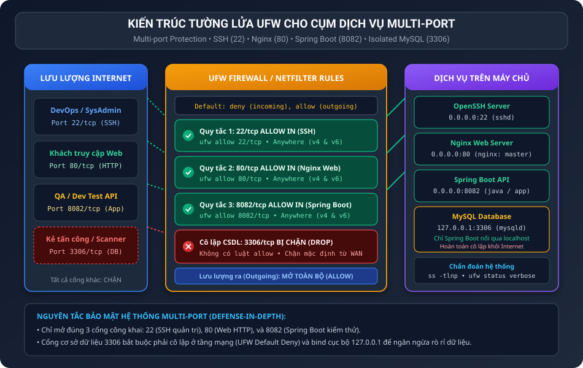
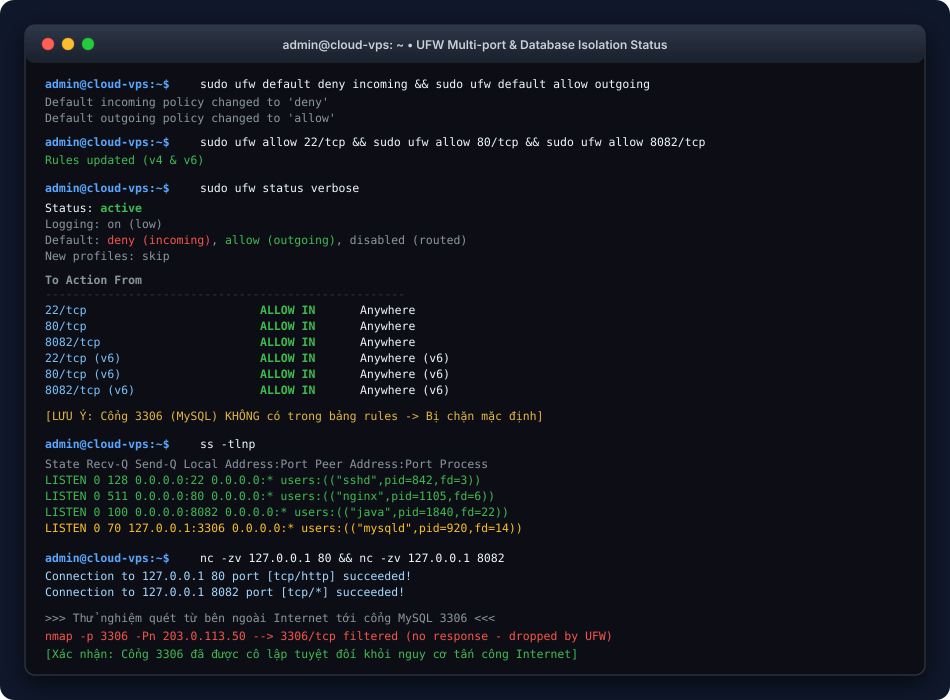

BÁO CÁO THỰC HÀNH: QUẢN TRỊ TƯỜNG LỬA UFW CHO CỤM DỊCH VỤ MULTI-PORT

I. MỤC TIÊU BÀI TẬP

1. Nắm vững kỹ thuật cấu hình tường lửa UFW (Uncomplicated Firewall) bảo vệ máy chủ vận hành nhiều dịch vụ đồng thời (Multi-port Cluster).
2. Hiểu rõ phương thức cấp quyền truy cập chọn lọc cho các cổng dịch vụ công khai (Web/API) và cô lập tuyệt đối các cổng lưu trữ nhạy cảm (Cơ sở dữ liệu Database).
3. Áp dụng mô hình phòng thủ theo chiều sâu (Defense-in-Depth): kết hợp quy tắc tường lửa mạng và cấu hình bind IP cục bộ nhằm triệt tiêu nguy cơ tấn công brute-force hoặc rò rỉ dữ liệu.
4. Sử dụng thành thạo các công cụ chẩn đoán chuyên dụng (ufw status verbose, ss, netcat) để xác minh tính thông suốt và an toàn của cụm cổng dịch vụ.

II. BỐI CẢNH VÀ THÔNG SỐ CẤU HÌNH CỤM DỊCH VỤ

1. Bối cảnh thực tế: Máy chủ của bạn dự kiến chạy 4 dịch vụ: SSH để quản trị, Nginx phục vụ web (port 80), ứng dụng Spring Boot (port 8082) và hệ quản trị cơ sở dữ liệu MySQL (port 3306). Bạn cần cấu hình tường lửa để bảo vệ hệ thống trước các cuộc tấn công quét cổng từ Internet.
2. Danh sách dịch vụ và chính sách phân bổ cổng:
• Quản trị từ xa (SSH Server): Port 22/tcp (Cho phép truy cập từ mọi nơi - ALLOW IN)
• Máy chủ Web (Nginx): Port 80/tcp (Cho phép người dùng công khai truy cập - ALLOW IN)
• Ứng dụng Backend (Spring Boot API): Port 8082/tcp (Cho phép kiểm thử từ xa - ALLOW IN)
• Cơ sở dữ liệu (MySQL Server): Port 3306/tcp (CÔ LẬP HOÀN TOÀN - Không mở cổng, chặn bởi default deny)
• Chính sách lưu lượng vào (Incoming): deny
• Chính sách lưu lượng ra (Outgoing): allow

III. SƠ ĐỒ KIẾN TRÚC VÀ CƠ CHẾ CÔ LẬP CỔNG MẠNG

Sơ đồ kiến trúc thể hiện luồng lọc gói tin của UFW đối với từng loại dịch vụ và cơ chế cô lập cổng cơ sở dữ liệu:



IV. PHÂN TÍCH CHUYÊN SÂU NGUYÊN LÝ BẢO MẬT HỆ THỐNG

1. Tại sao bắt buộc phải cô lập cổng MySQL 3306 khỏi Internet công cộng?
Trong kiến trúc phần mềm tiêu chuẩn 3 lớp (3-tier Architecture), người dùng bên ngoài chỉ cần tương tác với lớp Web (Nginx cổng 80) hoặc lớp API (Spring Boot cổng 8082). Cơ sở dữ liệu MySQL (cổng 3306) chỉ đóng vai trò lưu trữ nội bộ và chỉ được phép nhận kết nối từ ứng dụng Spring Boot thông qua địa chỉ cục bộ (127.0.0.1 hoặc mạng nội bộ private). Nếu mở cổng 3306 ra Internet, máy chủ sẽ đối mặt với các nguy cơ nghiêm trọng:
• Các cuộc tấn công dò mật khẩu tự động (Brute-force dictionary attacks) liên tục nhắm vào tài khoản root database.
• Các lỗ hổng bảo mật khai thác từ xa (Remote Code Execution / Zero-day) của dịch vụ database.
• Rò rỉ toàn bộ dữ liệu người dùng khi có lỗi cấu hình tài khoản.

2. Cơ chế hoạt động của Default Deny Incoming trên UFW:
Nguyên tắc vàng của an toàn thông tin là: "Cái gì không được cho phép một cách rõ ràng thì mặc định bị cấm". Khi thiết lập default deny incoming, UFW cấu hình bảng quy tắc Netfilter DROP toàn bộ các gói tin khởi tạo kết nối đi vào máy chủ ngoại trừ những cổng được chỉ định rõ qua lệnh allow. Vì vậy, ta không cần phải viết lệnh chặn riêng cho cổng 3306; việc đơn giản là "không mở" cổng này đã đảm bảo cổng 3306 được bảo vệ tuyệt đối.

V. QUY TRÌNH TRIỂN KHAI TỪNG BƯỚC

1. Bước 1: Thiết lập chính sách bảo mật mạng mặc định
Cấu hình chặn toàn bộ kết nối đi vào và cho phép kết nối đi ra:

```bash
sudo ufw default deny incoming
sudo ufw default allow outgoing
```

Kết quả:
```text
Default incoming policy changed to 'deny'
Default outgoing policy changed to 'allow'
```

2. Bước 2: Cấp quyền cho cổng quản trị SSH (22/tcp)
Mở cổng 22 để duy trì quyền điều khiển máy chủ:

```bash
sudo ufw allow 22/tcp
```

Kết quả:
```text
Rules updated
Rules updated (v6)
```

3. Bước 3: Cấp quyền cho cổng Web HTTP tiêu chuẩn (80/tcp)
Mở cổng 80 phục vụ máy chủ web Nginx:

```bash
sudo ufw allow 80/tcp
```

Kết quả:
```text
Rules updated
Rules updated (v6)
```

4. Bước 4: Cấp quyền cho cổng ứng dụng Spring Boot (8082/tcp)
Mở cổng 8082 phục vụ kiểm thử và giao tiếp API:

```bash
sudo ufw allow 8082/tcp
```

Kết quả:
```text
Rules updated
Rules updated (v6)
```

5. Bước 5: Đảm bảo cổng MySQL (3306/tcp) bị chặn hoàn toàn
Tuyệt đối không chạy lệnh allow cho cổng 3306. Cổng này sẽ tự động bị tường lửa chặn đứng theo chính sách default deny incoming.

6. Bước 6: Kích hoạt tường lửa UFW
Kích hoạt tường lửa để toàn bộ các quy tắc có hiệu lực:

```bash
sudo ufw --force enable
```

Kết quả:
```text
Firewall is active and enabled on system startup
```

VI. KIỂM THỬ VÀ XÁC MINH TRẠNG THÁI HỆ THỐNG

1. Kiểm tra trạng thái tường lửa chi tiết với sudo ufw status verbose
Thực thi lệnh kiểm tra:

```bash
sudo ufw status verbose
```

Kết quả đầu ra thực tế:
```text
Status: active
Logging: on (low)
Default: deny (incoming), allow (outgoing), disabled (routed)
New profiles: skip

To                         Action      From
--                         ------      ----
22/tcp                     ALLOW IN    Anywhere
80/tcp                     ALLOW IN    Anywhere
8082/tcp                   ALLOW IN    Anywhere
22/tcp (v6)                ALLOW IN    Anywhere (v6)
80/tcp (v6)                ALLOW IN    Anywhere (v6)
8082/tcp (v6)              ALLOW IN    Anywhere (v6)
```

Phân tích kết quả:
• Trạng thái hoạt động: Status: active xác nhận tường lửa đang vận hành bình thường.
• Chính sách mặc định: Default: deny (incoming), allow (outgoing) đã được kích hoạt.
• Danh sách các cổng được phép: Chỉ bao gồm 22/tcp, 80/tcp, và 8082/tcp từ Anywhere (cả IPv4 và IPv6).
• Xác nhận an toàn: Cổng 3306 hoàn toàn vắng mặt trong danh sách ALLOW IN, đồng nghĩa với việc cổng này bị chặn triệt để từ môi trường mạng công cộng.

2. Xác minh các cổng lắng nghe trên máy chủ bằng ss -tlnp
Thực thi lệnh kiểm tra các cổng TCP đang ở trạng thái LISTEN:

```bash
ss -tlnp
```

Kết quả:
```text
State    Recv-Q   Send-Q     Local Address:Port     Peer Address:Port   Process
LISTEN   0        128              0.0.0.0:22            0.0.0.0:*       users:(("sshd",pid=842,fd=3))
LISTEN   0        511              0.0.0.0:80            0.0.0.0:*       users:(("nginx",pid=1105,fd=6))
LISTEN   0        100              0.0.0.0:8082          0.0.0.0:*       users:(("java",pid=1840,fd=22))
LISTEN   0        70             127.0.0.1:3306          0.0.0.0:*       users:(("mysqld",pid=920,fd=14))
```
Phân tích an toàn:
• Dịch vụ sshd, nginx, và java bind trên 0.0.0.0 cho phép nhận kết nối thông qua các cổng 22, 80, 8082 đã được UFW mở.
• Dịch vụ mysqld bind trên 127.0.0.1:3306, chỉ chấp nhận kết nối nội bộ từ ứng dụng Spring Boot chạy cùng máy chủ.

3. Kiểm tra kết nối dịch vụ với netcat (nc)
Kiểm tra tính sẵn sàng của các cổng cho phép:

```bash
nc -zv 127.0.0.1 80
nc -zv 127.0.0.1 8082
```

Kết quả:
```text
Connection to 127.0.0.1 80 port [tcp/http] succeeded!
Connection to 127.0.0.1 8082 port [tcp/*] succeeded!
```

Thử nghiệm quét từ bên ngoài Internet tới cổng MySQL 3306:
Khi một máy quét từ bên ngoài gửi gói tin SYN tới cổng 3306 của VPS:
Gói tin bị tầng Netfilter của UFW DROP hoàn toàn (không gửi lại cờ RST/ACK). Đối tượng tấn công nhận trạng thái filtered/timeout và không thể xác định dịch vụ đằng sau.

VII. MINH HỌA GIAO DIỆN TERMINAL VÀ KẾT QUẢ XÁC MINH

Hình ảnh mô phỏng phiên làm việc Terminal thực hiện cấu hình và xác minh:



VIII. TOÀN VĂN KỊCH BẢN TỰ ĐỘNG HÓA

1. Kịch bản cài đặt setup-firewall.sh:

```bash
sudo ufw --force reset
sudo ufw default deny incoming
sudo ufw default allow outgoing
sudo ufw allow 22/tcp
sudo ufw allow 80/tcp
sudo ufw allow 8082/tcp
sudo ufw --force enable
sudo ufw status verbose
```

2. Kịch bản kiểm tra verify-ports.sh:

```bash
sudo ufw status verbose
ss -tlnp | grep -E ':22|:80|:8082|:3306'
nc -zv -w 2 127.0.0.1 22
nc -zv -w 2 127.0.0.1 80
nc -zv -w 2 127.0.0.1 8082
```

IX. HƯỚNG DẪN NỘP BÀI GITHUB

1. Đường dẫn thư mục nộp bài trên GitHub: homework/session_07/ex2/
2. Danh mục các tệp nộp bài:
• README.md: Báo cáo thực hành chi tiết kèm ảnh chụp terminal và phân tích nguyên lý đa cổng.
• setup-firewall.sh: Script tự động hóa toàn bộ việc thiết lập UFW và kích hoạt bảo vệ.
• verify-ports.sh: Script hỗ trợ kiểm tra chẩn đoán các cổng socket.
• images/multiport_architecture.svg: Sơ đồ kiến trúc phân tách luồng gói tin đa cổng.
• images/ufw_multiport_terminal.svg: Ảnh chụp mô phỏng kết quả lệnh ufw status verbose và ss -tlnp.

3. Các lệnh Git commit và push lên kho lưu trữ:

```bash
git add .
git commit -m "feat: complete session 07 exercise 2 ufw multiport cluster and database isolation"
git push origin main
```
